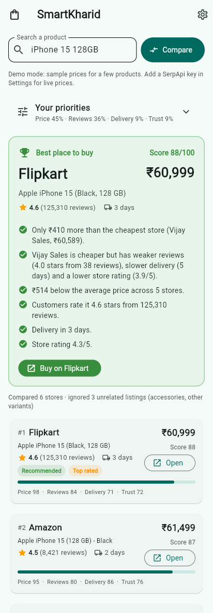
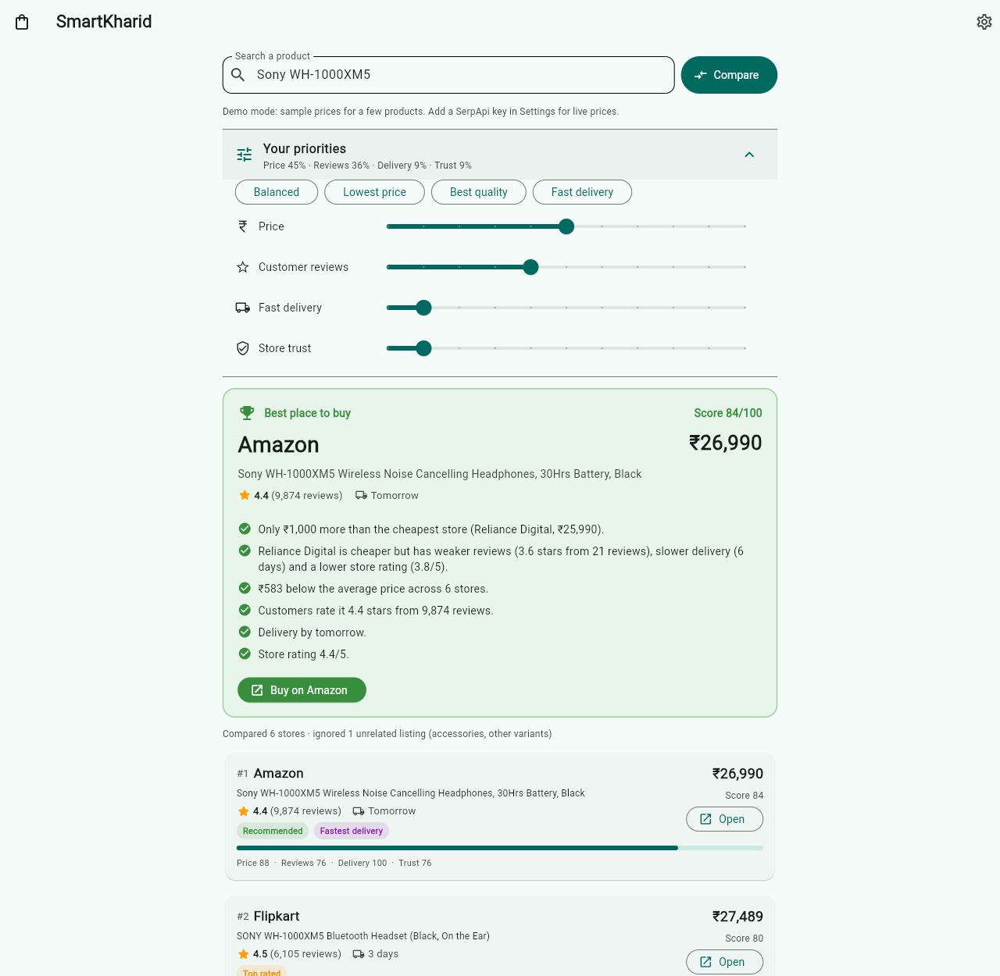

# SmartKharid: kahan se kharidein?

Ek hi product Amazon, Flipkart, Croma, Reliance Digital, Myntra jaise bahut saare stores par
milta hai, par har jagah price, reviews aur delivery alag hote hain. **SmartKharid** sab stores
ka data ek jagah laata hai, compare karta hai, aur batata hai ki **kis store se kharidna sabse
sahi rahega, aur kyun.**

The same product is sold on many stores at different prices, with different ratings and delivery
times. SmartKharid collects every store's offer, filters out look-alike listings, scores each store
on your priorities, and recommends one store with plain-language reasons.

One Python codebase runs on **Android, iOS, Windows, macOS** (plus Linux and web), built with
[Flet](https://flet.dev), which uses Flutter underneath.

| Phone | Desktop |
|---|---|
|  |  |

## Features

- **Search once, compare every store**: price + shipping, customer rating, number of reviews,
  delivery time, store rating, stock.
- **Same product only**: phone covers, screen guards, the "Pro/Plus" model, or the 256 GB variant
  when you searched 128 GB are filtered out automatically, so you never compare apples to cases.
- **Recommendation with reasons**, for example: *"Only ₹410 more than the cheapest store
  (Vijay Sales). Vijay Sales is cheaper but has weaker reviews (4.0 stars from 38 reviews), slower
  delivery (5 days) and a lower store rating."*
- **Your priorities**: sliders for Price / Reviews / Delivery / Store trust, plus presets
  (Balanced, Lowest price, Best quality, Fast delivery). Results re-rank instantly.
- **Buy button** opens the store page directly.
- Works **offline in demo mode**, or with **live prices** from Google Shopping (covers Amazon,
  Flipkart, Croma, Tata CLiQ and hundreds more).

## How the recommendation works

Every store's offer gets four scores from 0 to 100:

| Criterion | How it is scored |
|---|---|
| **Price** | Cheapest total (price + shipping) = 100. Each 1% costlier loses 3 points (10% costlier = 70). |
| **Reviews** | Rating corrected for review count with a Bayesian average: 5.0 from 3 reviews counts for less than 4.4 from 10,000 reviews. |
| **Delivery** | Next day = 100, falling to 0 at 8+ days. Unknown = 50. |
| **Store trust** | Seller/store rating when available. Unknown = 50. |

Final score = weighted average using your priority sliders. Out-of-stock offers are shown but never
recommended. If a store lists the product several times (different sellers), only its best listing
is kept. The logic is in [`scoring.py`](src/smartkharid/scoring.py) and
[`matching.py`](src/smartkharid/matching.py).

## Run it on your computer

Prerequisite: [uv](https://docs.astral.sh/uv/) (Python package manager).

```bash
cd smartkharid
uv sync                              # install dependencies
uv run flet run src/main.py          # desktop window (Windows / macOS / Linux)
uv run flet run --web src/main.py    # in the browser
uv run pytest                        # run the tests
```

To try it on your **phone without building**, install the "Flet" app from the Play Store / App Store,
then run `uv run flet run --android src/main.py` (or `--ios`) and scan the QR code.

## Live prices (real data)

Demo mode uses a small built-in catalog of **sample prices** (iPhone 15, Galaxy S24, Sony WH-1000XM5,
boAt Airdopes 141, Nike Revolution 7, Prestige Iris mixer grinder) so the app works without internet.

For real prices of any product:

1. Create a free account at [serpapi.com](https://serpapi.com) and copy your API key
   (the free plan includes a monthly search quota).
2. In the app, open **Settings** (gear icon), choose **Live (Google Shopping)**, paste the key, and pick
   your country.

The key is stored only on your device. On desktop you can also set the `SERPAPI_KEY` environment
variable.

Why not scrape Amazon/Flipkart directly? Their pages change often, block bots, and their terms of
use forbid scraping. Google Shopping already aggregates these stores with prices and ratings, and
SerpApi gives legal, stable access to it.

## Build installable apps

`flet build` creates the real app package. The first build downloads the Flutter SDK (and the Android
SDK for APKs), so it takes a while.

| Platform | Command | Build on | Output |
|---|---|---|---|
| Android | `uv run flet build apk` (or `aab` for Play Store) | Windows, macOS or Linux | `build/apk/*.apk` |
| iOS | `uv run flet build ipa` | macOS with Xcode + Apple Developer account | `build/ipa/` |
| Windows | `uv run flet build windows` | Windows with Visual Studio 2022 (C++ workload) | `build/windows/` |
| macOS | `uv run flet build macos` | macOS with Xcode | `build/macos/*.app` |
| Linux | `uv run flet build linux` | Linux | `build/linux/` |
| Web | `uv run flet build web` | any | `build/web/` (static site) |

**No Mac or Windows machine?** The GitHub Actions workflow
[`.github/workflows/smartkharid.yml`](../.github/workflows/smartkharid.yml) builds the Android,
Windows, macOS and web versions in the cloud. Go to **Actions → SmartKharid → Run workflow**
and download the results from the run's *Artifacts*. iOS needs your Apple signing certificate,
so build it on a Mac (see the [Flet iOS docs](https://flet.dev/docs/publish/ios)).

## Project structure

```
smartkharid/
├── pyproject.toml            # dependencies + app name/icon for `flet build`
├── src/
│   ├── main.py               # app entry point
│   ├── assets/icon.png       # app icon (all platforms)
│   └── smartkharid/
│       ├── ui.py             # screens: search, priorities, recommendation, store list, settings
│       ├── service.py        # fetch from all sources in parallel → filter → rank
│       ├── matching.py       # is this listing the same product? (variants, accessories)
│       ├── scoring.py        # scores, badges and the "why" explanation
│       ├── models.py         # Offer, Weights, Comparison
│       ├── formatting.py     # ₹1,23,456 style prices
│       └── sources/
│           ├── demo.py       # offline sample catalog
│           └── serpapi.py    # live Google Shopping prices
└── tests/                    # pytest suite
```

## Adding another data source

Any class with a `name` and an async `search(query) -> list[Offer]` method works. For example,
a source using the Amazon Product Advertising API or Flipkart Affiliate API:

```python
class MyStoreSource:
    name = "My Store"

    async def search(self, query: str) -> list[Offer]:
        ...  # call the API, return Offer(store=..., title=..., price=..., url=..., rating=..., review_count=...)
```

Add it to `build_sources()` in `ui.py`. All sources are queried in parallel; if one fails, the
others still show results with a warning.

## Limitations

- Demo prices are illustrative, not real.
- Live data is only as good as Google Shopping's listing: its rating is often the product's overall
  rating rather than the store's own, and delivery time is not always given.
- Product matching uses text rules, so a strangely titled listing can be dropped or kept by mistake.
  The app shows how many listings it ignored.
- Always confirm the final price on the store before paying.
